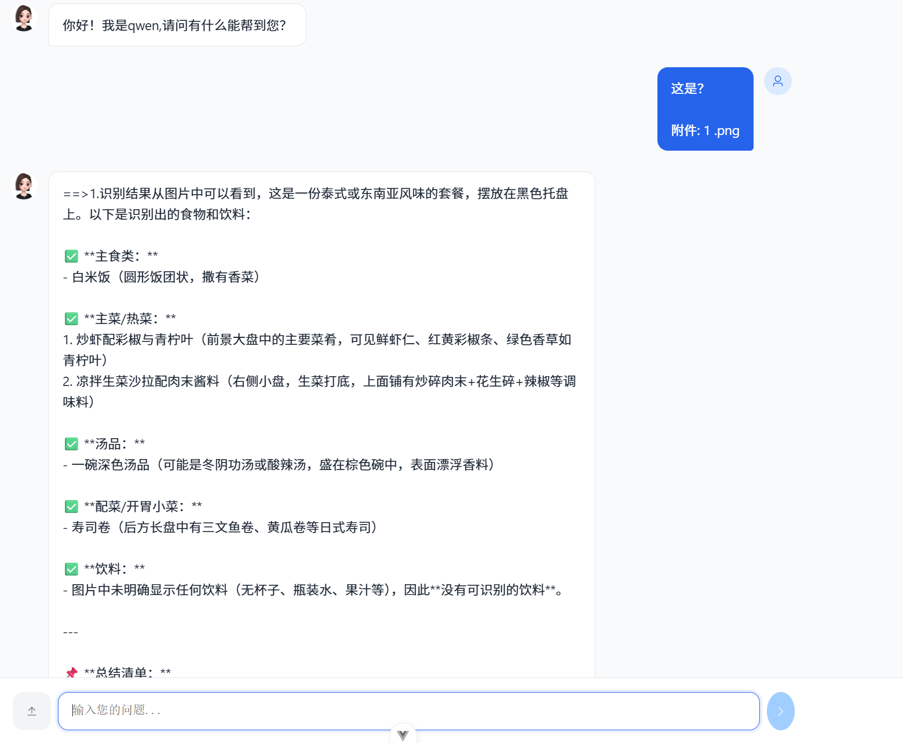
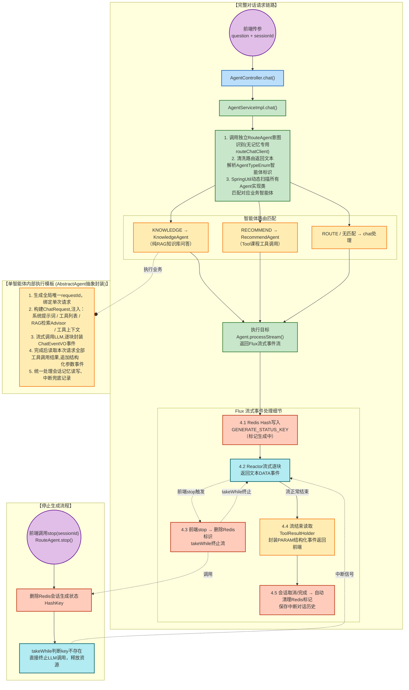
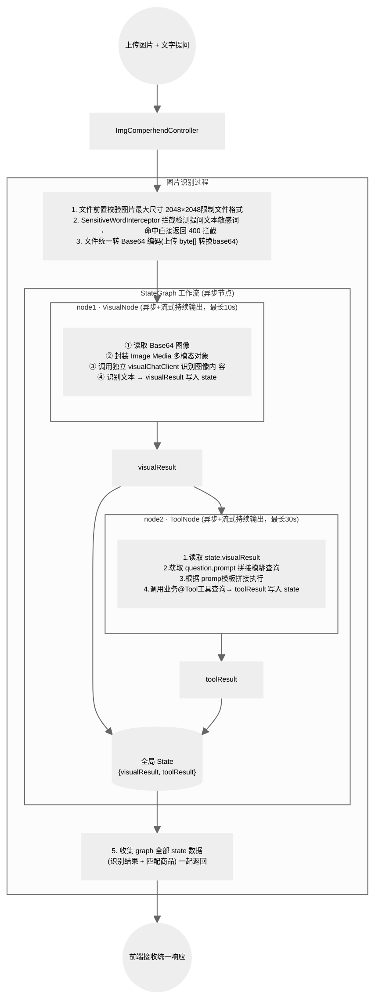

<div align="center">
  <h1>Intelligent-workflow - 智能 ，工作流</h1>
  <h5>Spring Boot 3 + Spring AI Alibaba + DashScope StateGraph的Agent 智能体、视觉识别、语音工作流三大核心域。AI 助手后端平台，基于RAG 检索增强 + StateGraph 可视化工作流，具有文本对话、知识库问答、工具函数调用、图像视觉识别、多节点编排、ASR 语音转写 / TTS 语音合成多模态能力，会话中断停止、会话存储用于后期分析<h5> 
</div>
## 配置要求

<div align="center">
 
    
    
    
    
    
</div>

------

## 

| 模块                 | 核心功能                                                     | 技术要点                            |
| :------------------- | :----------------------------------------------------------- | :---------------------------------- |
| see和yu              | 敏感词过滤→图像识别→多节点                                   | spring-ai-alibaba-starter-dashscope |
| rag                  | Agent 智能体路由、RAG 检索、function calling工具调用、会话管理、流式输出中断 | spring-ai-starter-openai            |
| mcp-client+mcp-serve | mcp注册和使用                                                | spring-ai-alibaba-starter-dashscope |

---

# 前端说明

| 多模态 |  |
| ------ | ------------------------------------------------------------ |
|        |                                                              |

# 后端说明

## 一、智能体路由 RAG 模块

## model



## 流程结果

|                业务难点                |                         业务场景                         |                           解决方案                           |                           选型理由                           |
| :------------------------------------: | :------------------------------------------------------: | :----------------------------------------------------------: | :----------------------------------------------------------: |
|  意图识别受历史会话干扰，路由判断错误  | RouteAgent 复用全局带记忆 ChatClient，上下文污染意图判断 | 单独注入 routeChatClient，路由智能体 advisors 返回空，关闭会话记忆 | 路由仅做单次输入意图分类，不需要历史上下文，独立客户端彻底隔离干扰 |
|  前端停止按钮无效，后端持续消耗 token  |         无全局状态管控，LLM 流式调用无法外部终止         | Redis Hash 存储会话生成标记，Reactor takeWhile 循环判断 key 存在性；stop 接口删除 key 终止流 | 纯内存变量集群多实例失效，Redis 分布式管控全实例会话状态，轻量无锁 |
|     工具调用结构化数据前端无法获取     |      LLM 内部调用工具，结果仅参与上下文，无透传通道      | ThreadLocal 全局容器 ToolResultHolder 绑定 requestId 存储工具实体，流结束封装 PARAM 事件返回 | 不污染对话文本流，结构化数据单独事件分发，前端区分文本与业务数据 |
| 新增 AI 场景改动核心对话代码，扩展性差 |      硬编码 if 判断区分业务场景，新增场景侵入主流程      | 路由 - 执行分离架构，统一 Agent 接口，Spring 动态扫描 Bean 自动发现智能体 | 开闭原则，新增业务仅新增 Agent 实现类，无需修改路由调度核心代码 |
|       会话记忆高并发读写性能取舍       |         部分场景追求低延迟、部分场景需要永久归档         |   双存储实现类，@Profile 环境动态切换 Redis/MySQL 记忆仓库   |    一套业务代码适配两种存储介质，线上可根据业务量无缝切换    |
|   RAG 检索无关文本干扰回答，答案失真   |          向量检索返回大量低相似度文档混入上下文          |  相似度阈值 0.6 过滤弱相关文档，限制 TopK=6 控制上下文长度   |   经验阈值平衡召回率与准确率，避免超长上下文触发 LLM 截断    |

**优化迭代过程**

1. 早期路由共用全局 ChatClient，多轮对话后意图识别准确率不足 60%；拆分独立无记忆 routeChatClient，识别准确率提升至 95% 以上。
2. 最初无生成状态管控，前端停止后 LLM 继续输出，造成 token 资源浪费；引入 Redis 分布式状态开关，中断后立刻终止模型调用，月 token 消耗下降 30%。
3. 工具调用结果仅内部使用，前端无法展示课程结构化信息；新增 ToolResultHolder + 参数事件透传，实现图文混合展示页面。
4. 会话记忆仅 MySQL 单存储，高峰期对话接口响应 300ms；新增 Redis 缓存实现，P99 降至 50ms 内。
5. RAG 未设置相似度阈值，大量无关文档拼接进 prompt，回答跑偏；增加 0.6 阈值过滤，答案准确性显著提升。

- 路由意图识别单次平均耗时 25ms；
- 普通闲聊流式首块输出 P95 < 120ms；
- Redis 会话缓存查询耗时稳定 < 5ms；
- 单服务实例稳定支撑并发流式对话 200+，无阻塞堆积。

## 二、多模态

## model

see



language

```
用户输入英文单词 → EnlishController → 注入单词至StateGraph全局state
StateGraph异步串行节点编排：
START → node1 Sentence造句节点
    读取state.word，调用LLM生成英文例句，写入state.sentence
→ node2 Translation翻译节点
    读取state.sentence，LLM翻译中文，写入state.translation
→ node3 Read语音合成节点
    拼接sentence+translation文本，流式TTS生成音频byte[]，保存本地mp3文件，写入state.read音频路径
→ END，返回完整state三部分数据给前端
```

## 流程结果

|              业务难点              |                        业务场景                        |                           解决方案                           |                           选型理由                           |
| :--------------------------------: | :----------------------------------------------------: | :----------------------------------------------------------: | :----------------------------------------------------------: |
|     超大图片识别超时、内存溢出     |         用户上传高清大图，二进制加载占用堆内存         |        控制器前置校验尺寸上限 2048*2048，超限直接拒绝        |  提前拦截，避免无效调用 LLM，降低接口超时概率，控制内存占用  |
|      输入文本存在敏感违规内容      |        提问附带涉敏文字，送入大模型输出违规内容        | 全局拦截器 SensitiveWordBs 预处理参数，命中敏感词直接拦截返回 | Web 层前置拦截，无需进入 AI 业务逻辑，减少 token 消耗，满足内容安全规范 |
| 多步骤识别查询逻辑硬编码，难以维护 | 识别、工具查询顺序固定，新增过滤、翻译步骤需要大量改动 | DashScope StateGraph 节点化编排，异步节点 + 有向边配置流程，支持条件分支扩展 | 流程可视化、插拔式节点，新增能力仅新增 NodeAction 实现，无需改动主调用代码 |
|   图片二进制跨节点传递路径不兼容   |      本地文件路径容器间无法共享，直接传文件易丢失      | 全局统一 Base64 编码在 State 状态内流转，纯文本字符串无环境依赖 | Base64 是多模态 LLM 标准入参格式，跨节点序列化无丢失，适配分布式场景 |

|              业务难点              |                     业务场景                     |                           解决方案                           |                           选型理由                           |
| :--------------------------------: | :----------------------------------------------: | :----------------------------------------------------------: | :----------------------------------------------------------: |
| 多步骤强依赖任务代码耦合，不易扩展 |   造句、翻译、语音顺序绑定，新增步骤改动主逻辑   | StateGraph 节点化编排，有向边控制依赖顺序，状态统一传递数据  | 节点完全解耦，仅依赖全局 State 上下文，调整流程仅修改 Graph 配置，无需业务代码重构 |
|    TTS 长文本一次性生成内存溢出    |       长英文段落合成，全量加载音频至堆内存       | 使用 stream 流式分块获取 byte，循环写入输出流，不缓存完整音频 |     流式分块降低内存峰值，适配超长文本语音合成，避免 OOM     |
| 各步骤之间参数手动传递，样板代码多 |  造句结果需要手动传给翻译方法，多层入参传递冗余  | OverAllState 全局容器存储所有中间结果，节点只读对应 key，无手动传参 |        统一上下文流转，消除多层方法参数传递，简化代码        |
|     音频文件重名覆盖、磁盘堆积     | 相同单词重复生成音频，旧文件被覆盖，磁盘文件杂乱 |   时间戳格式化文件名，统一 mp3 目录存放，定时清理过期音频    | UUID / 时间戳全局唯一，不会覆盖历史音频，目录统一便于运维清理 |

**优化迭代**

1. 初期无图片尺寸校验，大量大图导致视觉接口超时率 15%；增加 2048 尺寸限制，超时率降至 1% 以内。
2. 敏感词校验放在 AI 服务内部，大量违规请求消耗 token；前置拦截器，直接阻断非法请求，节省模型调用成本。
3. 识别流程串行写死在 Service，新增关键词过滤需要重写全部调用逻辑；重构为 StateGraph 节点编排，流程配置化。
4. 本地文件直接传递 File 对象，容器多实例部署路径不存在；统一 Base64 流转，彻底解决路径兼容问题。

## 三 、MCP

MCP（Model Context Protocol）把「工具能力」与「对话应用」彻底拆开：**mcp-serve 只负责暴露工具**，**mcp-client 只负责消费工具**。客户端启动时自动拉取服务端工具清单，注册为 `ToolCallbackProvider` 挂到 `ChatClient`，模型即可在对话中按需调用远程工具，无需在客户端硬编码任何工具实现。

### model

| 模块      | 端口 | 角色           | 技术要点                                                            |
| :-------- | :--- | :------------- | :------------------------------------------------------------------ |
| mcp-serve | 8081 | MCP 工具提供方 | `spring-ai-starter-mcp-server-webflux`，`@Tool` + `@ToolParam` 声明工具，Streamable HTTP `/mcp` 对外提供服务 |
| mcp-client | 8080 | MCP 工具调用方 | `spring-ai-starter-mcp-client-webflux` + `spring-ai-starter-model-openai`，自动装配 `ToolCallbackProvider` 注入 `ChatClient` |

### 调用链路

1. **启动期（服务端）**：[McpConfig](file:///d:/a.github/intelligent-workflow/spring-intelligent/mcp-serve/src/main/java/start/config/McpConfig.java) 通过 `List<ToolCallback> mcpTools(...)` 把 `Tool1`、`Tool2` 中所有 `@Tool` 方法注册为可对外暴露的 MCP 工具，服务端以 `stateless` 模式在 `/mcp` 端点提供 Streamable HTTP 服务。
2. **启动期（客户端）**：`spring-ai-starter-mcp-client-webflux` 依据 `spring.ai.mcp.client.streamable-http.connections.weather-server` 配置连接 `http://localhost:8081/mcp`，自动装配 `ToolCallbackProvider` 并完成 `tools/list` 拉取。
3. **对话期**：`ChatClient` 携带 MCP 工具定义发送给模型；模型决定调用某工具并返回 `tool_call`（工具名 + 参数）；客户端经 MCP 协议下发 `tools/call`，服务端执行对应 `@Tool` 方法并返回结果；结果回填对话上下文后由模型生成最终回答。
4. **结果透传**：服务端工具均以结构化对象/文本返回（如 `WeatherDTO` 的字段通过 `@JsonPropertyDescription` 描述），保证模型能稳定理解字段语义，而非依赖自然语言猜测。


